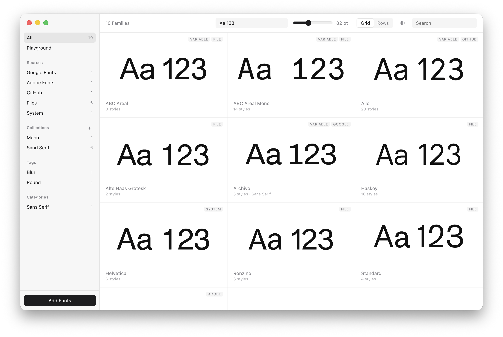

# FontLib

A personal font library for macOS. It holds only the fonts you deliberately add, from Google Fonts, Adobe Fonts, GitHub, local files and the fonts already installed on your Mac. FontLib keeps each font's metadata and source links, previews everything with a minimal interface that leaves the specimens to do the talking, and helps you pair typefaces for projects.

<picture>
  <source media="(prefers-color-scheme: dark)" srcset="docs/screenshots/library-dark.png">
  
</picture>

## What it does

**An intentional library.** Nothing is imported automatically and no catalog is browsed in bulk. Every family is one you added.

**Five sources, one Add dialog.** Paste a link or choose files:

| Source | How you add it | What's stored |
| --- | --- | --- |
| Google Fonts | Paste a specimen or `css2` link. Metadata comes from the family's `METADATA.pb` in the [google/fonts](https://github.com/google/fonts) repository: no API key, no catalog. | The link and metadata only. Previews load from Google. |
| Adobe Fonts | Paste a web project link (`use.typekit.net/<kit>.css`), pick the families. Save several kits; sync after changing a project on fonts.adobe.com. | The kit link only. Previews load through the kit. |
| GitHub | Paste a repository link. FontLib lists the fonts in the latest release (including inside release zips) and on the default branch, grouped by folder, and you pick which to import. | Copies of the chosen files, with the repo, release tag or commit, and license recorded. |
| Local files | Drop files, folders or zips anywhere, or choose them. | Copies in the library folder. |
| System fonts | Pick from the fonts installed on your Mac (a scan that is never saved). | The path and PostScript name only. Moved fonts are found again after macOS updates; vanished ones are marked missing, never deleted. |

Duplicates are merged: the same family arriving from several sources becomes one family with several sources. Each style keeps every format the designer provided (TTF, OTF, WOFF2…) side by side.

**Browsing.** A grid or rows layout, shared preview text and size, search by name, designer, tag or category, light and dark themes. Organise with collections (including project collections), tags and hand-assigned categories. Select several families to tag, categorise, collect or merge them in one go.

**Family pages.** Every style of a family, an editable large preview, a style picker with variable axis sliders, OpenType feature toggles, a glyph map with code points and glyph names, source links, license, notes, and a saved default style (with axis values) used everywhere the family is previewed. Merged families group their styles by the family each font file declares.

**Playground.** Pair a heading font with a body font from your library, adjust size, line height, tracking and weight per role on an editable sample document, step through your library with `[` `]` and `Shift+[` `Shift+]`, save pairings and add them to collections. **Copy CSS** produces ready-to-paste rules: embed links for Google and Adobe, `@font-face` blocks with relative paths for your stored files, and `local()` for system fonts.

**Your files stay yours.** There is no conversion: "export" is Show in Finder on the original files. **File → Export Library** writes all metadata as JSON plus the stored files to a folder, and **Import Library** restores it.

## Install and run

FontLib is a personal project and isn't distributed as a signed app. To run it from source you need macOS and [Node.js](https://nodejs.org) 22 or later.

```sh
git clone https://github.com/taipinc/fontlib.git
cd fontlib
npm install      # also downloads Electron
npm run dev      # starts the app with live reload
```

Other scripts:

| Command | What it does |
| --- | --- |
| `npm run build` | Builds the main process, preload script and renderer into `out/` |
| `npm run preview` | Runs the built app |
| `npm run typecheck` | Type-checks the main and renderer code |

## Where your library lives

Everything is in `~/Library/Application Support/FontLib/`:

- `library.db`: an SQLite database with families, styles, sources, tags, collections, pairings and settings
- `fonts/<family>/…`: copies of fonts imported from files and GitHub

**File → Show Library Folder** opens it. The folder is self-contained, so it can be backed up or moved as a whole.

## Network use

FontLib talks to the network only when you ask it to, plus previews:

- **raw.githubusercontent.com** for Google Fonts metadata, when you paste a Google link
- **api.github.com** and GitHub downloads, when you paste a repository link (anonymous requests are limited to 60 an hour; lookups are cached)
- **fonts.googleapis.com / fonts.gstatic.com** to preview Google families
- **use.typekit.net / p.typekit.net** to preview Adobe families (Adobe counts these as page views of your web project)

Previews that need the network show an "Offline" state instead of a substitute font when there's no connection.

## How it's built

[Electron](https://www.electronjs.org) with a [Vite](https://vite.dev)-built [React](https://react.dev) renderer, TypeScript throughout, plain CSS with custom properties for theming.

- **Main process** (`src/main`) owns the filesystem, SQLite ([better-sqlite3](https://github.com/WiseLibs/better-sqlite3)), network requests and font parsing ([fontkit](https://github.com/foliojs/fontkit)).
- **Renderer** (`src/renderer`) talks to it only through a typed preload bridge (`src/shared/api.ts`), with context isolation, sandboxing and a strict Content Security Policy.
- Fonts reach the window through a private `fontlib://` protocol that serves only files registered in the database, so the renderer never sees file paths.

The original product spec is in [`Font Library App — Spec.md`](Font%20Library%20App%20%E2%80%94%20Spec.md).

## Status

FontLib is built for one person's workflow and is still evolving. Not supported: installing or activating fonts (copy the files from Finder and install them yourself), syncing between machines (use Export/Import Library), Windows and Linux.
